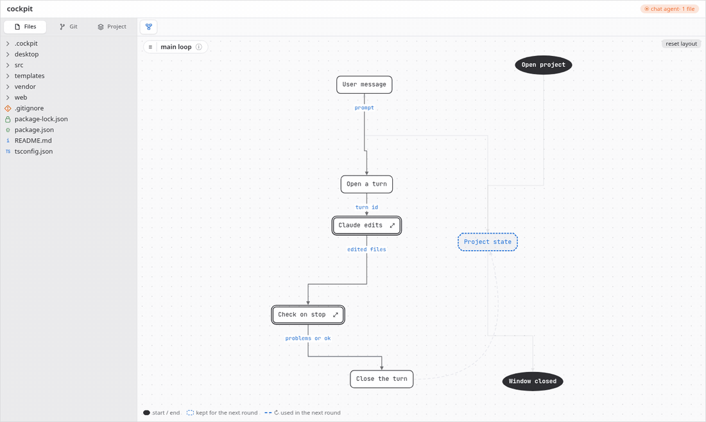
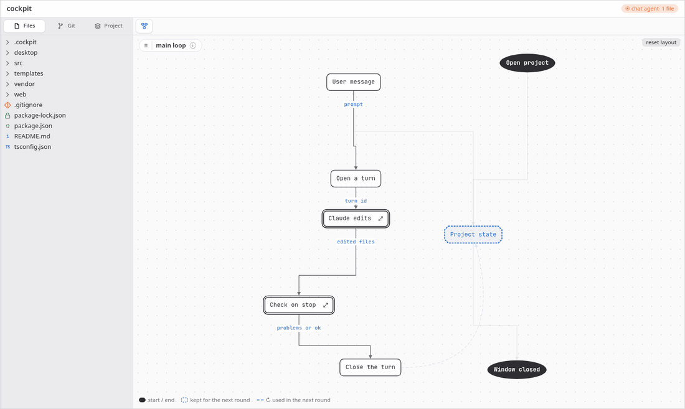

<h1 align="center">cockpit</h1>

<p align="center">
  <b>See what your AI agents are building, while they build it.</b><br>
  A live map of your project, drawn and kept true by the agents, beside the files, git, terminals and the agent chat.
</p>

<p align="center">
  <picture>
    <source media="(prefers-color-scheme: dark)" srcset="docs/media/map-dark.gif">
    
  </picture>
</p>

Agents write a lot of code fast; reading all of it is not an option. Cockpit has them keep a short
description of the project in its repo (`.cockpit/`: the features and a few diagrams of how the
code works, every box linked to real code) and shows it live, with what is changing right now
projected onto it. You lead at whatever depth you choose and can always go one level deeper:
**diagram → detail diagram → the code of one box.**

- 🗺️ **A map that stays true.** The agents draw the diagrams; cockpit checks every link against the
  code and sends the agent back when its description drifts.
- ✨ **Changes light up.** Boxes whose code changed turn amber, boxes the agent is editing glow, and
  the diagram list says which diagrams a change reaches.
- 🤖 **The agent, built in.** Claude Code runs in the side panel on your own login, its turns
  recorded, its work checked by your project's guardrails before it stops.
- 🌿 **Git, review and terminals** in the same window, so you rarely leave it.

<p align="center">
  <picture>
    <source media="(prefers-color-scheme: dark)" srcset="docs/media/changes-dark.gif">
    
  </picture>
  <br><sub>An edit lands: its boxes turn amber and ☰ counts the diagrams it reaches. Revert it from the git tab, then check the features on the project tab.</sub>
</p>

## Run it

```sh
npm install
npm run build                               # the page (web/ → web/dist)
npm run serve -- ~/Projects/slipangle       # prints http://127.0.0.1:4173/?token=…
npm run serve -- ~/Projects/slipangle --host 0.0.0.0   # reachable from your network
npm test                                    # the server's parsers, the access check, git actions
```

Only a page opened with the server's token gets in: open the link it prints once, and the
browser keeps a cookie for that port. The token is kept per project in cockpit's state folder,
so a page left open keeps working when the server restarts; the desktop app makes a new one for
each server it starts. Listening on 127.0.0.1, the server also refuses requests that call it by
another name (a site pointing its own domain at 127.0.0.1).

Desktop app (Linux), a GTK 4 / libadwaita window (WebKitGTK 6) around the same server:

```sh
desktop/install.sh            # once: needs gtk4-devel libadwaita-devel webkitgtk6.0-devel
cockpit ~/Projects/slipangle  # or open "cockpit" from the app menu (reopens the last project)
cockpit --pick                # choose a project in a new window ("New Window" on the launcher icon, or Ctrl+Enter in the app grid)
```

It starts the server on a free port, shows the page, and stops the server when the window
closes. GNOME draws the window's rounded corners and shadow; the page's header is the title bar.
The project name in the header opens another folder or a recent one (Ctrl+O), in the same
window; the project you leave keeps its server running, so switching back is instant.
On a screen faster than 60Hz where WebKit can't follow the display's refresh (NVIDIA), the stock
WebKitGTK still draws at 60: `COCKPIT_WEBKIT_LIB=<dir of a patched libwebkitgtk-6.0> desktop/install.sh`
makes the app-menu launcher use one (~/Projects/Forks/webkit-120hz). `COCKPIT_DEVTOOLS=1` adds
Inspect Element to the right-click menu. Everything is bundled, so it works offline. The plan is to move the server to Rust piece
by piece, and the UI later once it stops changing.

Working on the page: `npm run dev:web` rebuilds it on every change; reload to see it (Ctrl+R or
F5 in the desktop app).

## Where cockpit keeps things

Nothing about the projects you open is kept in this checkout:

- settings and your corrections: `~/.config/cockpit/projects/<project>/` (`index.json`);
- workspaces: `~/.config/cockpit/workspaces/<name>/` (below);
- what cockpit generates (code index, turns, chats) under
  `~/.local/share/cockpit/projects/<project>/` (`$COCKPIT_STATE` moves it), turn snapshots in
  `~/.local/share/cockpit/snapshots/` (a git store of cockpit's own: no objects, refs or
  worktrees in the project's `.git`), model-call cache in `~/.local/share/cockpit/.cache/`.

`data/<project>/` and `out/<project>/` in the checkout are still used for projects that already
have them.

## What's on the page

- **Map** (first tab): the agents' diagrams. Hover a box for what it is, click it for a card with
  its code links (ⓘ by the breadcrumb does the same for the diagram), double-click (or scroll in)
  to go into its detail diagram or its code; Esc, scrolling out or the breadcrumb comes back up.
  ☰ by the breadcrumb lists every diagram as a small tree (by which box zooms into which); click
  one to go there. Drag boxes to arrange them; the arrangement is saved in `.cockpit/layout.json`.
  Boxes whose code changed (not committed) are dashed amber, and ☰ and the list count the
  diagrams and boxes a change reaches; boxes the agent is editing glow.
- **Files**: open a file and its uncommitted changes show in place, like an editor: a green bar
  by added lines, blue by changed ones, a red mark where lines were removed (click it to see
  them, or tick "show removed"). ↑ ↓ jump between changes. A small diagram floats over the code
  and lights up the boxes whose code is on screen.
- **Git** (sidebar): branch and its upstream, the PR / MR the branch has open (via `gh` or `glab`:
  state, review, checks; one click reviews it), what isn't committed (hover a file to stage it or
  revert it, two clicks), and the history of all branches as a graph (hash and all refs in the
  tooltip); a commit opens as its patch. Sections fold.
- **Project** (sidebar): the summary, the features by status, tests, links that went out of date,
  guardrails and size. The header only shows what is happening: a running agent, a review in
  progress, a guardrail check that fails.
- **Review mode** (git tab, "review a merge request…"): pick one of the project's open merge
  requests (through `glab` or `gh`, whichever the remote needs, with your own login) or any two
  branches. Cockpit fetches and checks out the branch (only when nothing is uncommitted) and
  compares it with the point where it left its target, like the merge request's own diff:
  diagram boxes whose code it changes turn violet, boxes it adds to the diagrams green, the
  diagram list counts the changed boxes, files show their changes against the target, and the
  git tab lists every file it touches. End the review from there, or go back to the branch you
  were on. The review in progress is kept in `review.json` in the project's state dir.
- **Terminals** (Ctrl+`): real shells in the project. The agent can read them. Ctrl+K asks for a
  command in words and puts it on the prompt, never runs it.
- **Chat**: an agent cockpit runs itself (below).

Links: `?file=path&line=n`, `?commit=sha`, `?tab=files|git|project`, `?panel=features|tests`, `?at=diagram&box=node`.

## Agent chat

Cockpit runs Claude Code through the Claude Agent SDK, on your Claude Code login (no API key),
with your user and project settings. Auto mode decides what it may do; when it wants you, an
Allow/Deny card shows in the chat. A model menu (opus by default) and one button that sends, or
stops the agent while it works; messages typed meanwhile reach it as it goes. Paste or drop
images into a message.

- **Conversations** are Claude Code sessions, named Chat 1, Chat 2… in the order they started:
  the title at the top lists this project's sessions, including ones started in a terminal, and
  reopens any of them; hover one to delete it. + starts another; the old one stays in the list.
  Cockpit keeps its own view of each in `chats/` in the project's state dir.
- **Meters** under the message box: how full this conversation's context is, and how much of your
  plan's 5-hour and weekly limits you've used (the numbers behind `/usage`; it reads them through
  an experimental SDK call, and hides them if that stops working).
- While the agent works, turns are recorded (`turns/` in the project's state dir) so its files light up live.
- When it stops, the `.cockpit/` check runs against the live code index; if the description no
  longer matches the code, the agent is sent back to fix it (up to 3 times), with the likely
  right link for each wrong one. On a project without `.cockpit/`, "Describe this project" starts
  it from `templates/cockpit-README.md`.

### Workspaces

Projects that work together (a service and its clients, a library and the apps built on it) can
be put in a workspace, like an editor's multi-root workspace. Each project keeps its own server,
index, chat and terminals; the workspace tells each one about the others.

```
~/.config/cockpit/workspaces/<name>/workspace.json   { "projects": ["~/src/engine", "~/src/tools"] }
~/.config/cockpit/workspaces/<name>/SYSTEM.md        how they fit together, kept by the agents
```

- The chat's agent can **read** the other projects, and its brief lists them with a line on each
  (from their `.cockpit/project.json`, else their README). An **edit** in another project needs
  your yes, on an Allow/Deny card, even in auto mode.
- `SYSTEM.md` says which project owns what, who calls whom and through what, and how they are built
  together. The agents write it the first time it matters and keep it true; you can edit it too.
- The header shows the workspace before the project's name; its menu lists the projects. In the
  desktop app "open" switches the window to that project and ↗ opens it in a window of its own.
  A project you switch away from keeps its server running, with its terminals and agent, so
  switching back is instant; they all stop when the window closes. In a browser, "open" starts
  the desktop app on it.
- When the C++ index runs in a build image, the other projects are mounted there too, read-only,
  for builds that compile another project's headers or sources from its checkout.
- A change to the workspace reaches the chat from its next conversation.

A Claude Code session outside cockpit can be recorded too, with hooks in the project's
`.claude/settings.local.json` that call `src/hook.ts start|tool|stop`.

## The project's description (`.cockpit/`)

Written and kept true by the agents, never by hand (the brief they follow is
`.cockpit/README.md`, copied from `templates/cockpit-README.md`):

- `project.json`: a summary and the features, each with a status (working, partial, broken,
  planned), the modules it lives in, and a note on what's missing.
- `diagrams/<id>.json`: as many diagrams as the project needs, each answering one question where a
  picture beats two sentences. Kinds: loop, pipeline, dataflow, zones. Every box links to code
  ("crate/module" or "crate/module::Type::fn"; for C/C++ "project/path/File.cpp::Type::fn"), and
  has a short tldr.
- `layout.json`: where you placed the boxes (written by cockpit).

`npm run check-arch -- <project dir>` checks it against the code by hand (no model call).
`npm run modules -- <project dir> [filter]` lists every module and item exactly as links must
write them; the agent's brief tells it to use it before writing links. Test code needs no feature.

## Guardrails (`.cockpit/guardrails.json`)

What keeps agents' work right without re-reading every line: **checks** (commands that pass or
fail: types, lint, tests, a script that drives the app) and **rules** (decisions about how the code
is written, each with why and where it is enforced). The project tab opens them as layers,
strongest first: *design* (the code makes the wrong thing impossible), *static* (a check finds it
without running the program), *verification* (a check runs it and looks), *prose* (only written
down; it lists the instruction files agents read, like CLAUDE.md and skills). A prose rule has a
"harden it" button that asks the agent to turn it into a check.

- **Opt-in.** Without the file nothing runs. "Ask the agent to set them up" has it write checks
  that use the tools the project already has; it lives in `.cockpit/` only (a check script goes in
  `.cockpit/checks/`), so a project's own setup is never changed. Results are kept in cockpit's
  state folder.
- **At the end of a chat turn that edited files**, cockpit runs the checks. The agent is sent back
  (up to 3 rounds) only for a check that **passed before its turn**: failures that were already
  there show in the tab and aren't pinned on it. Claude Code sessions in a terminal don't run them
  yet.
- When you correct how code is written, the agent's brief (`templates/guardrails.md`) has it
  propose a rule at the strongest layer it can enforce. cockpit's own are in its `.cockpit/`.

## TypeScript / JavaScript projects

A repo with a `package.json` (or `tsconfig.json`) at the top, and no Rust, Zig or CMake manifest
there, is scanned by cockpit itself (`src/skeleton-ts.ts`): no tool to install. Packages are the
dirs with a `package.json`; modules are files (`.ts`, `.tsx`, `.js`, `.svelte`, `.vue`…), named
`package/path` without the extension and a leading `src/` (`src/serve.ts` is `cockpit/serve`);
items are top-level functions, classes and their methods, types and variables (a `.svelte` file's
`<script>`). Edges are relative imports. A top-level dir that is a Rust crate (cockpit's own
`desktop/`) is indexed with rust-analyzer and added in. Path aliases (`@/x`, `$lib`) aren't followed.

## C and C++ projects

A repo with a `CMakeLists.txt` at the top or in a top-level folder (and no `Cargo.toml`) is read
as C/C++ (`src/indexer.ts`, `src/skeleton-cpp.ts`), into the same skeleton shape as Rust, so the
map, chat, turns and checks work unchanged:

- **Index**: [scip-clang](https://github.com/sourcegraph/scip-clang/releases) (put the binary in
  `~/.local/bin`) over the project's `compile_commands.json` files, found as
  `<dir>/build[/<variant>]/compile_commands.json` and merged into one; cross-compile ones (arm,
  aarch64) lose to host ones. CMake writes them with `-DCMAKE_EXPORT_COMPILE_COMMANDS=ON`. The
  server indexes in the background (minutes on a large repo); the page fills in when it's done.
- **Groups** are the top-level folders with a `CMakeLists.txt` (the "crates"); **modules** are
  files (`engine/World.hpp`, `engine/World.cpp`, without `src/` or `include/`); **edges** are
  "uses something defined in" plus `#include`s. Installed copies of project headers
  (`build/.../include/...`) count as the source file they were copied from. Libraries are named
  after their outermost namespace (`Eigen`, `boost`, `nlohmann`); `std` is left out.
- **Build containers**: when the compile commands point at paths that only exist in an image (a
  devcontainer), say so in `~/.config/cockpit/projects/<project>/index.json`; scip-clang then runs
  in that image, with the repo mounted read-only at the same path:

  ```json
  { "image": "my-build-image:latest",
    "compdb": ["engine/build/compile_commands.json"] }
  ```

  Both keys are optional (`COCKPIT_CXX_IMAGE` also sets the image). Without `compdb`, every
  compile database found is used. Without an image, a dev container is used when the repo has one
  (`.devcontainer/devcontainer.json`): its `image`, or the image its `build` Dockerfile makes,
  built by cockpit as `cockpit-dev-<repo>:<hash>` the first time and again when the files change.
- Turn snapshots reuse the repo's compile databases, with source paths moved to the snapshot;
  files added in a turn are only indexed once the build has seen them.
- Tests: `*_test.cpp`, `test_*.cpp`, `*Test.cpp` or anything under `test/`, with their
  GoogleTest / Catch2 / Boost.Test cases, else their `test_*()` functions (plain `main()` tests),
  else the file as one test.

## How it works

- `src/serve.ts`: the server. It watches the project's folders and git, works out the page's state
  (diagrams, features, tests, git, what changed down to the function), and pushes only the parts
  that changed over server-sent events.
- `src/codeindex.ts`: the SCIP index of the working copy (rust-analyzer, or scip-clang through
  `src/indexer.ts`), read into crates, modules and items (`src/skeleton.ts`,
  `src/skeleton-cpp.ts`); rebuilt in the background when a source file changes.
- `src/arch.ts`: reads and checks `.cockpit/`.
- `src/chat.ts`, `src/term.ts`, `src/ask.ts`: the agent, the terminals, the ask line.
- `web/`: the page, in Svelte 5 + TypeScript, built with Vite. Diagrams are drawn with Cytoscape
  and updated in place, never torn down, so the view doesn't jump while things change.

## History

Earlier experiments (decision recaps, a generated module map, layered turn reviews, a generated
description, a feature board) shaped this and were removed once the one view replaced them; they
are in the git history before November 10, 2026.
